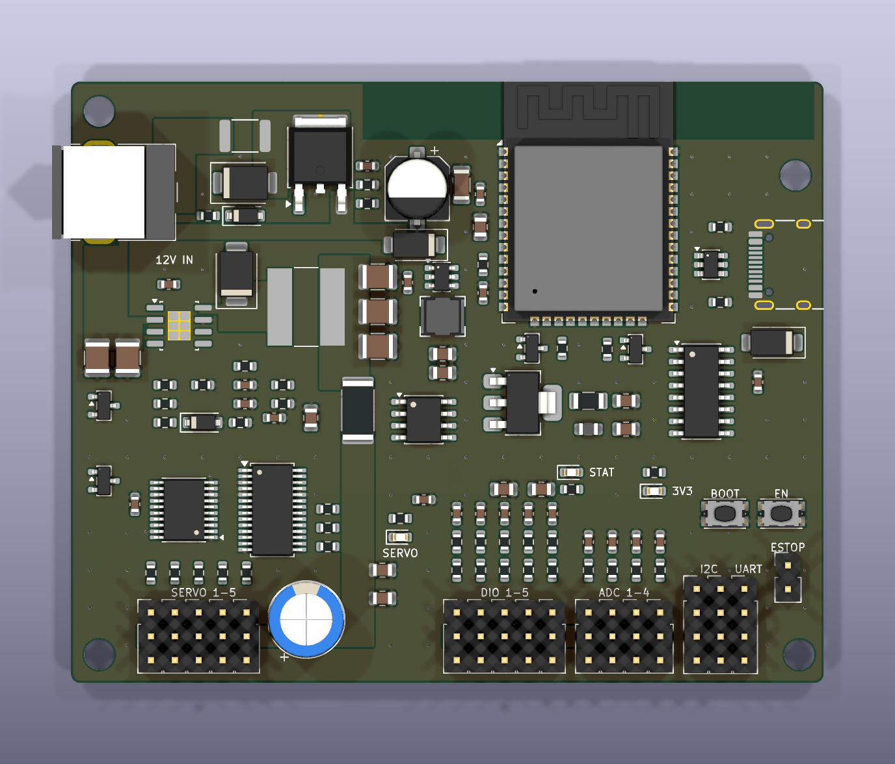

# PKT ESP32 Robot Arm Controller (Rev B)

> **สถานะ:** ยังสั่งผลิตไม่ได้ การเดินลายอัตโนมัติยังไม่สำเร็จ จึงยังไม่มี Gerber ภาพนี้คือการวางอุปกรณ์ ยังไม่ใช่บอร์ดที่เดินลายครบ และยังไม่ได้ทดสอบกับบอร์ดจริง

บอร์ดควบคุมแขนกล 5 แกนสำหรับ servo SG90/MG90S ขนาด 80 × 64 มม. ใช้ PCA9685, 74AHCT541, TPS54560B, AP63205 และ INA219 พร้อม E-stop แบบ fail-safe

ต้องต่อสวิตช์ NC หรือจั๊มเปอร์ที่พอร์ต ESTOP ไม่เช่นนั้น servo จะไม่ได้ไฟ

เอกสาร: [schematic](docs/schematic.pdf), [BOM พร้อมราคาประมาณการ](bom_with_prices.csv)
