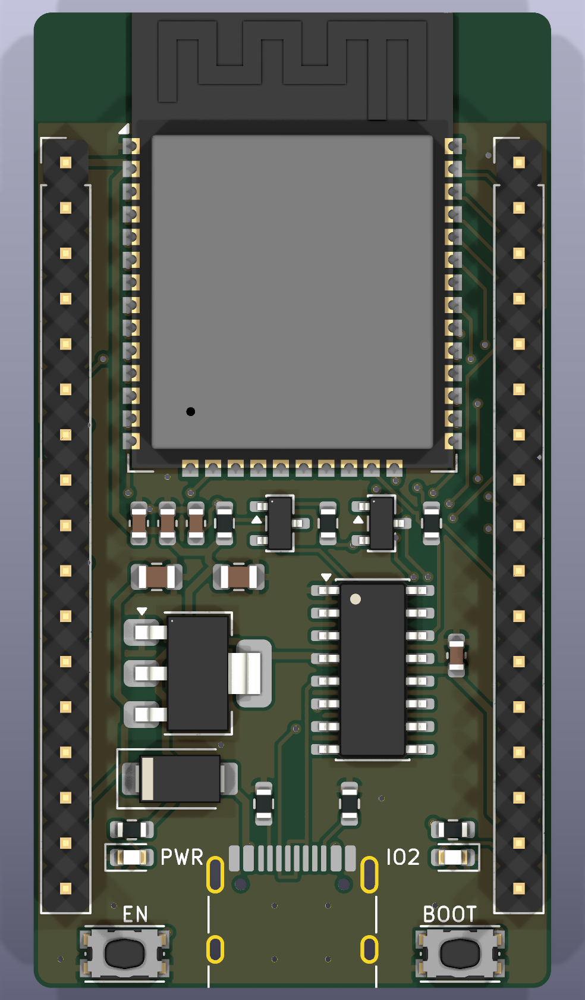

# PKT ESP32 Dev Board (Rev A)

> **สถานะ:** มี Gerber พร้อมสั่งผลิต แต่ยังไม่ได้ทดสอบกับบอร์ดจริง

บอร์ด 2 ชั้น ขนาด 29 x 54.6 มม. หนา 1.6 มม. ใช้ ESP32-WROOM-32E, USB-C, CH340C และ AMS1117-3.3
ขา header ห่างกัน 25.4 มม. ระยะ pitch 2.54 มม.

- เปิดใน KiCad: `esp32_devboard.kicad_pro`
- สั่งผลิตแผ่น: `fab/esp32_devboard_gerber.zip`
- รายการอุปกรณ์: `fab/bom.csv`  ตำแหน่งอุปกรณ์: `fab/positions.csv`
- แก้วงจรหรือตำแหน่งที่ `tools/design.py` แล้วรัน `tools/build.sh`
  (ถ้าแก้ใน KiCad โดยตรง อย่ารัน build.sh ทับ)

ใช้ใน Arduino/PlatformIO เลือกบอร์ด "ESP32 Dev Module"; LED อยู่ที่ IO2
กด BOOT ค้างแล้วกด EN เพื่อเข้าโหมดแฟลชด้วยมือ ปกติ DTR/RTS จัดการให้อัตโนมัติ

ERC มี error 1 รายการโดยตั้งใจ: CH340C ต่อ V3 เข้ากับ VCC ตาม datasheet สำหรับไฟ 3.3V
แต่ไลบรารีกำหนด V3 เป็น power output จึงชนกับเอาต์พุตของ AMS1117

DRC ไม่มี error มี warning 2 จุดจาก silkscreen ของ USB-C ที่ยื่นพ้นขอบ

เอกสาร: [schematic](docs/schematic.pdf), [ด้านล่างบอร์ด](docs/pcb_bottom.png)
