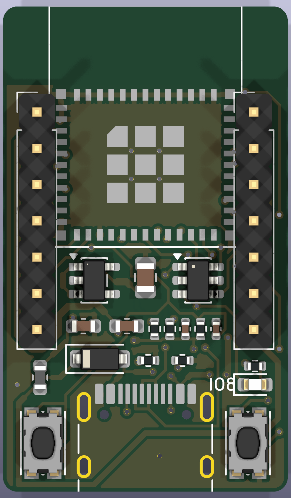
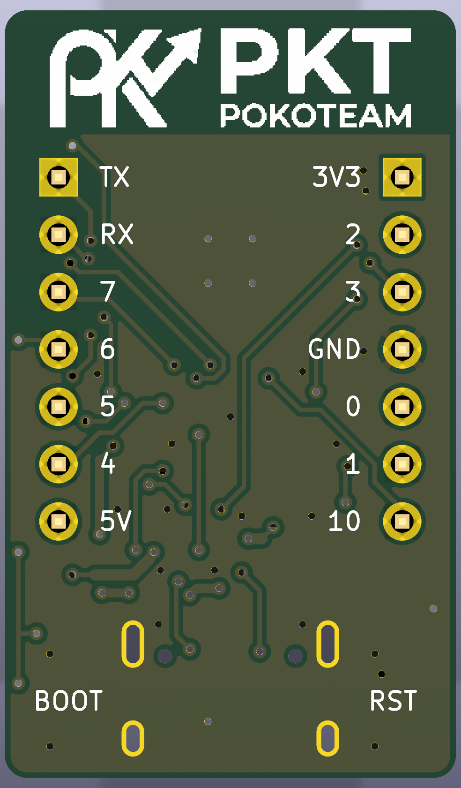

# PKT ESP32-C3 Mini (Rev A)

 

> **สถานะ:** พร้อมส่งไฟล์เข้า JLCPCB แต่ยังไม่ได้ทดสอบกับบอร์ดจริง ผลด้าน ESP-NOW ต้องวัดจากบอร์ดจริง

บอร์ดจิ๋วสำหรับงานไร้สาย ขนาด 20 × 34 มม. ใช้ ESP32-C3-MINI-1, USB-C, LDO AP2112K-3.3 และ USBLC6

DRC ไม่มี error ลายเชื่อมครบทุกจุด เหลือ warning เรื่อง silkscreen และ thermal relief, ERC ผ่าน 0 รายการ

สั่งผลิต: ดู [fab/HOW_TO_ORDER.txt](fab/HOW_TO_ORDER.txt) | เอกสาร: [schematic](docs/schematic.pdf)
